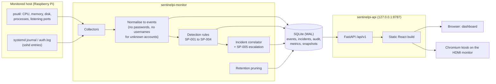
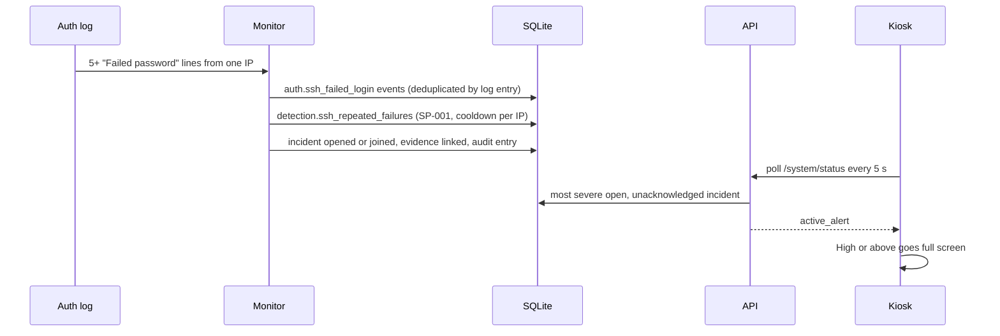

# Architecture

SentinelPI is two processes sharing one SQLite database. The **monitor** writes; the **API**
mostly reads and serves the dashboard. Neither takes any action against the host: it observes
and explains.

## Data flow of one detection

## Components
| Area | Where | Notes |
|---|---|---|
| Collectors | `backend/src/sentinelpi/collectors/` | Metrics, processes, ports; auth source is journald first, file fallback. Each reports `ok / unavailable / error` instead of failing the loop. |
| Events | `events.py`, `storage/events_repo.py` | One Pydantic model; ids are deterministic so re-reading a log never duplicates. |
| Detection | `detection/rules/` | One class per rule: thresholds, cooldown, evidence. Rule outputs are events too. |
| Correlation | `incidents/` | Key is (host, subject); idempotent; per-event savepoints. |
| Storage | `storage/` | Plain SQL, ordered migrations with checksums, WAL, retention and size cap. |
| API | `api/` | Versioned `/api/v1`, keyset pagination, one error shape, host and origin checks. |
| Frontend | `frontend/src/` | React + TypeScript, polling hooks, hand-drawn SVG charts, no chart library. |
| Packaging | `deploy/` | systemd units, installer, kiosk autostart. |

## Design decisions
- **SQLite, no server.** One writer and a few readers on a Pi; WAL gives concurrent reads. Backups use SQLite's online backup API.
- **Polling, not websockets.** Simple, robust to restarts, and a 5 s kiosk poll is cheap (a status request takes about 9 ms on the Pi).
- **Detections are events.** They appear in the same timeline as the evidence and flow through the same correlator.
- **No remediation.** Nothing blocks, kills or changes anything. A wrong detection can only be a wrong notification.
- **Local only.** The API binds to loopback and has no login, so it is never exposed.
